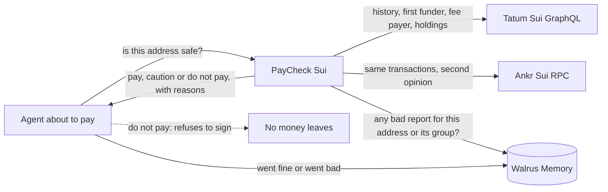

PayCheck Sui stops an AI agent from paying a Sui address when another agent's bad payment, stored in Walrus Memory, reaches that address through a real on-chain link: on real mainnet wallet groups it stopped 18 of 20 wallets it had never seen, and wrongly stopped 0 of 10 ordinary wallets.

**What one agent learns, every agent knows.**

Built on two sponsor tools: Tatum reads the Sui chain (wallet history, who paid its first SUI and its fees, what it holds, the price of a paid check) and shows each check's real Tatum calls on screen; Walrus Memory carries the warning from one agent to the next.
It works on any address. The person being paid doesn't need to sign up, sign anything or know I exist.

Live app: https://paycheck-sui-app.onrender.com · Code: https://github.com/Sireadell/paycheck-sui · Proof page: https://paycheck-sui-app.onrender.com/proof

> **The question it answers:** my agent is about to pay this Sui address. Should it?

## The problem

Two AI agents. Agent A pays a Sui address and the money is gone. Agent A now knows that address is bad.

A day later Agent B is about to pay a different address that the same person controls. Agent B has no idea, because what Agent A learned stayed inside Agent A.

PayCheck puts that lesson in shared Walrus Memory, and finds the link between the two addresses on the chain. So Agent B gets stopped on an address it has never seen.

## Try it in one minute, in your browser

No install and no wallet.

1. Open https://paycheck-sui-app.onrender.com
2. Press **Try the wallet Agent B was about to pay**. It fills in an address no agent has seen. Wait about 25 seconds.
3. The answer is **do not pay**. Open the evidence rows: the shared first funder, the shared fee payer, and Agent A's report with its Walrus Memory id.
4. Flip the memory switch off and press check again. The same wallet now says **pay**. That is the whole point: the link was always there, and only the stored report turns it red.
5. Open **What Tatum read for this check** to see every Tatum call that check made.

AI agents can call the same check with no setup: `claude mcp add --transport http paycheck-sui https://paycheck-sui-app.onrender.com/mcp`.

## Check the numbers in one minute (terminal)

No keys and no signup for the first two commands. You need Node 22.

Install and recount every published number from the saved result files:

```
npm install
npm run reproduce
```

The last line should be `0 differences`. It recounts row by row from `data/real-set/results.json`, `bench/results/real.json` and `data/prescan/verified.json`, not from stored totals, and exits with code 1 if anything disagrees.

Run the tests (recorded mainnet answers, no network):

```
npm test
```

230 tests pass.

Ask the live server about a real wallet from the real set (rs-01, a group tied by one shared first funder), with memory off and then on:

```
curl "https://paycheck-sui-app.onrender.com/api/check?address=0x36684098e89e315e57b8be53513a56e595452c7106de0f5c468262ba571a2964&memory=off"
curl "https://paycheck-sui-app.onrender.com/api/check?address=0x36684098e89e315e57b8be53513a56e595452c7106de0f5c468262ba571a2964&memory=on"
```

Every answer carries `verdict`, `code`, `reason`, `evidence` (each row labelled FACT, GUESS or REPORT), `memoryIds`, `changedByMemory`, `withoutMemory` and a count of the Tatum and Ankr calls it took. If no bad report reaches the wallet, both answers say "pay, linked, no bad history". That's on purpose (see the rules below).

See the measured numbers and the memory counters:

```
curl https://paycheck-sui-app.onrender.com/api/proof
curl https://paycheck-sui-app.onrender.com/api/failures
curl https://paycheck-sui-app.onrender.com/api/stats
curl https://paycheck-sui-app.onrender.com/health
```

## How it works

1. Before paying, the agent asks PayCheck about the address.
2. PayCheck reads the address's history on Sui through Tatum. It looks for the wallet that sent it its first SUI, and the wallet that paid its network fees.
3. It asks Ankr about the same transactions, as a second opinion.
4. It asks Walrus Memory for any report of a bad payment, to this address or to any wallet tied to it by one of those links.
5. It answers **pay**, **caution** or **do not pay**, with every reason labelled and every report shown with its memory id and who wrote it.
6. After paying, the agent can report "went fine" or "went bad". That report goes into Walrus Memory, and every agent reads it on its next check.

### One check, drawn out



### The rule that keeps it honest

Being linked isn't the same as being unsafe. An exchange sends the first SUI to thousands of honest wallets, and a payroll wallet pays fees for a whole team.

So a link on its own never gives a red answer. With no report anywhere in the group, the answer is "pay, linked, no bad history", and the links are only shown. Red needs a stored report of a bad payment that reaches the address through a real link. The full table is in [docs/VERDICT_RULES.md](docs/VERDICT_RULES.md).

That's why memory matters here. Turn it off and the checker still finds the links, but it can't say no.

### Why Sui

On Sui a transaction can have its fee paid by a different wallet from the one sending the money, and that fee payer (the "gas sponsor") is written into the transaction. Two wallets whose money came from different places can still share one fee payer, which ties them to one operator. In the real set, 8 of the 20 groups are tied this way, and PayCheck found 7 of those 8.

## Best Walrus Memory: "memories that visibly change the product"

Walrus Memory is where the warning lives. Without it, Agent A's report sits inside Agent A's own program and is gone when that program stops. In Walrus Memory it's shared, it survives a restart, and every agent reads it without anyone passing it along.

### What is stored

Every memory starts with one fixed header line, then a JSON body:

```
PAYCHECK v1 kind=<kind> address=<0x...> group=<g-...> origin=<origin>
```

| Memory | Written when | What it changes later |
|---|---|---|
| verdict | Every check, in the background (one write took 15 to 25 seconds when I measured it) | A fresh verdict for the same address is recalled on the next check, and the answer shows how many Tatum calls it saved (`memorySavedCalls`) |
| outcome | An agent reports "went bad" or "went fine". One memory per group id, so every linked wallet can find it | A "went bad" report turns a direct link red for the whole group |

`origin` says where a memory came from (`check`, `prescan`, `bench-train`, `agent-a`, `agent-b` or `k2-test`), so the counters split them honestly. Memories are kept in separate namespaces (labelled spaces inside one Walrus Memory account): `live`, `shared-outcomes`, `bench-train`, `agent-a`, `agent-b` and `k2-test`. Test memories never count and can never change an answer. Across 30 test writes, my wallets showed no SUI spent.

### How it is recalled

Recall in Walrus Memory is a search by meaning, not an exact lookup. So each check asks for the wallet, its first funder, its gas sponsor and their group ids, up to 100 results each, in `live` and `shared-outcomes`. Then it keeps only results whose header has the exact address or group id. A recall that times out is retried, and a failed recall never blocks the answer: the answer says memory was degraded.

### The memory switch

`memory=on` or `memory=off` on `/api/check`, and a switch on the first screen. Every answer also carries `withoutMemory`, so the same call shows both answers side by side, and `changedByMemory` with the memory ids that made the difference.

| Measured | Result | File |
|---|---|---|
| Held-back benchmark cases where memory changed the answer | 18 of 30, all group wallets going to "do not pay" | `bench/results/real.json` |
| Pre-scan memories recalled and verified by exact address | 171 of 200 | `data/prescan/verified.json` |
| Live "memories changed an answer" counter | read it live, read back from Walrus after each start | `GET /api/stats` |

About the pre-scan: before launch I ran PayCheck on 200 public Sui addresses, picked by a fixed rule, and stored each verdict with `origin=prescan`, so memory isn't empty on day one. They aren't user activity and they can never count as memory changing an answer. Then I asked Walrus Memory for each one by its exact address. 171 came back with the right stored verdict. The other 29 are stored but not counted: for 23 the search ran but didn't return that verdict, and 6 hit errors or timeouts.

### Two agents, one memory

I ran this for real on Sui mainnet on 9 Nov 2026, with two separate programs. For the test I made three fresh wallets. One of them, `0xa5516f223a1859e3d7dfcb658a6f9e6cfbc6a00da024af364a0998be24165db3`, sent the first SUI to the other two and paid network fees for both, so they share a first funder and a gas sponsor.

1. The shared test wallet (`0xc7f7...93ca`, which sends every payment in these runs) paid 0.001 SUI to `0xac311b8a190d696ec5c525bcff8528175715402cd8c46f8c3edab84ea74e8061`, a test wallet that Agent A controls ([transaction](https://suiscan.xyz/mainnet/tx/2D3j8SqvZFWhwTPy5i9Ru6P1VFkvUM5Kuc36PqReK8rw)). Agent A then reported that payment as bad. The burn is staged: nobody took the money, I had Agent A report it bad on purpose. The report is memory `V6yH0O1nbbcEp5yRz34iY0dqZpVatKV1kXbScXGdL3U`.
2. Agent B was given only `0xee973cdbfd30f458243f919f50a1657b15454c0534478022426350980f583719`, an address it had never seen. PayCheck found the shared funder and fee payer, followed them to Agent A's report, and answered "do not pay" (`GROUP_BAD_OUTCOME`), citing that memory id. With memory off, the same check answered "pay, linked, no bad history". Agent B saved its refusal as memory `YQsds7BZ8_ipm0PDpaELg6UkIfNPKo2epJvj1Jxh6y4`.

You can rerun Agent B's check yourself: the "Try the wallet Agent B was about to pay" button on the live page fills in that address with memory on.

One limit. The two agents are two programs, each signing with its own delegate key, on one shared Walrus Memory account. They read the same shared space, so this is not two accounts and not two users. The saved run is `data/cross-agent/latest.json`.

### What the next agent sees

The first screen lists the last five shared warnings (`GET /api/warnings`): who reported, when, and the memory id. A bad-outcome report also saves a short profile note of the wallet (first funder, fee payer, age, transactions read), so the next agent recalls more than a yes or no. Neither of these changes a verdict.

## Tatum Sui RPC integration

Every chain read comes from Tatum's Sui GraphQL endpoint (`https://sui-mainnet.gateway.tatum.io/graphql`):

| Read | Used for |
|---|---|
| Transactions by address, oldest first, from Tatum's data floor, with balance changes | A wallet's history, who sent it its first SUI, the other wallets that funder paid |
| Gas sponsor field on each transaction | The Sui-only link: who paid the fee |
| Latest checkpoint | How fresh the data behind each answer is |
| Transactions in one checkpoint | The pick rules for the real set and the pre-scan |
| Transaction by digest | Reading back each proof transaction of the real set, and reading a paid check's payment back |
| Balances, objects and SuiNS name of an address (one call) | The "holdings" evidence row: what the checked wallet and its first funder hold. Evidence only, it never changes a verdict |
| Reference gas price | The "network fee now" line next to the holdings, read once a minute at most |
| Tatum exchange rate (SUI in USD, a REST call, not GraphQL) | The dollar price shown when a paid check asks for payment |

How it stays reliable:

- One shared limit of 2.5 requests a second for the whole process, under the free plan's 3 a second. A rate-limited or failed call is retried with a growing pause.
- Every listing sets `afterCheckpoint` at Tatum's data floor. Without it the listing errors.
- Every answer counts its own Tatum calls and failures. On the real set a check took 4.10 Tatum calls on average (largest 5) reading 50 transactions per wallet, and 5.79 (largest 14) reading 200. A check reads the address's balance too, which is one of those calls. Those numbers are the saved benchmark runs, which read history and balance only. The live server also reads holdings for the wallet and its funder and the network fee, so a live check takes about 2 to 3 more calls.
- Building the real set took about 3,900 Tatum calls over 57,631 sampled checkpoints.

The check screen shows the real Tatum calls of that check (how many, which kind, median time) and the holdings, so you can see what Tatum was asked. What I tested and left out, with the date, is in [docs/TATUM.md](docs/TATUM.md): Tatum's plain JSON-RPC route answers 404 for Sui (its docs now point Sui users to gRPC, which needs a separate client), Tatum notifications do not list Sui, and address screening does not cover Sui.

### Second opinion from Ankr

Ankr's Sui JSON-RPC re-reads the same transactions. All 90 proof transactions in the real set were read from both Tatum and Ankr, and both agreed on the sender, the fee payer and success for all 90. On a live check the answer says "Ankr agrees on X of Y links". Ankr keeps less history per address than Tatum, so some links are checked one transaction at a time.

## Agent tool (MCP)

AI agents can call PayCheck as an MCP tool (the plug-in format assistants like Claude, Cursor and others use to call outside tools). One tool, `check_payee(address)`, runs the same check as the website and returns the same answer. Don't sign the payment on `do not pay`.

Add the hosted address, no keys and nothing to install:

```
claude mcp add --transport http paycheck-sui https://paycheck-sui-app.onrender.com/mcp
```

Clients that only run local tools can use the `mcp-remote` bridge: `npx mcp-remote https://paycheck-sui-app.onrender.com/mcp`. The hosted address keeps no session and shares the same per-visitor limit as `/api/check` (10 a minute). To run the tool from your own copy instead (your own keys, the live or test memory space):

```
claude mcp add paycheck-sui -- node --env-file=/path/to/total-recall/.env /path/to/total-recall/mcp/server.js
```

Config for other clients is in [docs/MCP.md](docs/MCP.md). Walrus also ships its own Memory MCP. This is a different tool: it answers "should I pay this address?" and uses Walrus Memory inside.

## Best Use of Agent Payments: "x402 or MPP settled on Sui"

There are two ways to pay for a check, both in SUI on Sui mainnet. The plain route (`POST /api/paid/check`) and an x402 route (`GET /api/x402/check`). The x402 route follows the x402 foundation's v2 spec for the `exact` scheme on Sui (network `sui:mainnet`, asset `0x2::sui::SUI`): the server answers 402 with a `PAYMENT-REQUIRED` header, the agent signs a SUI transfer and sends it in `PAYMENT-SIGNATURE`, and the server simulates it, sends it, and answers with a `PAYMENT-RESPONSE` receipt. There is no outside facilitator: this server settles the payment itself. Both routes have a real mainnet payment on record: the x402 one is [2AzVXWV2...S4z5qUaL6](https://suiscan.xyz/mainnet/tx/2AzVXWV2Jnntsk5zSijwGBWaxAMPCXRpcFNS4z5qUaL6), and sending the same payment again was refused. MPP is not claimed. Details in [docs/PAYMENTS.md](docs/PAYMENTS.md).

**The check is enforced inside the payment step.** The agent refuses to sign when the answer is "do not pay". In the saved run it refused `0xfa908e71fc537e28e04e580bb968ee22fcbd03c31fe92a4f8aad4e35fe575a84` ("do not pay", `OUTCOME_BAD_SELF`, citing memory `S9Lg93qfmbZ7_YhulweVbkigg_mBojpMqWh3Ij4qbU4`) and sent no transaction. That address is a fresh wallet I made and reported bad in a setup step, not a stranger's wallet: I didn't want to name anyone's real wallet as bad. Then it paid `0xe1b6e64f397d6120e4a9350209b2b835052c7aee51e78f860931ab6891133029`, an ordinary wallet from the real set (rc-01), 0.001 SUI in [transaction `2Wx6UC8XTAzcwfTceurmbPcyFtgDS2cUU2V4wpoEQCve`](https://suiscan.xyz/mainnet/tx/2Wx6UC8XTAzcwfTceurmbPcyFtgDS2cUU2V4wpoEQCve). Saved run: `data/refuse-then-pay/latest.json`.

**A check can be bought per call.** `POST /api/paid/check` answers HTTP 402 with a price in SUI and a one-time id, and the server reads the payment back through Tatum before it answers. I ran one paid check on Sui mainnet: 0.001002431 SUI in [transaction `5Le61QyWQtRoWz458KRWysu4VZAcu5ToBEBopb6nVE9R`](https://suiscan.xyz/mainnet/tx/5Le61QyWQtRoWz458KRWysu4VZAcu5ToBEBopb6nVE9R), and the answer came back. Sending the same transaction again was refused with HTTP 409, so one payment buys one check. Saved run: `data/paid-check/latest.json`.

## Sui mainnet record

Everything below happened on Sui mainnet. The paying wallet in these runs is `0xc7f7...93ca`.

| What | Value |
|---|---|
| Receiving address for paid checks | `0x7c666f1f64c4b1ee5e27024be2e8947692e89abfe47fd3e1c1c9d36f55613c2d` |
| Two-agent run, Agent A's staged bad payment | [2D3j8SqvZFWhwTPy5i9Ru6P1VFkvUM5Kuc36PqReK8rw](https://suiscan.xyz/mainnet/tx/2D3j8SqvZFWhwTPy5i9Ru6P1VFkvUM5Kuc36PqReK8rw) |
| Agent A's report in Walrus Memory | `V6yH0O1nbbcEp5yRz34iY0dqZpVatKV1kXbScXGdL3U` |
| Agent B's refusal in Walrus Memory | `YQsds7BZ8_ipm0PDpaELg6UkIfNPKo2epJvj1Jxh6y4` |
| Refuse-then-pay run, the payment to an ordinary wallet | [2Wx6UC8XTAzcwfTceurmbPcyFtgDS2cUU2V4wpoEQCve](https://suiscan.xyz/mainnet/tx/2Wx6UC8XTAzcwfTceurmbPcyFtgDS2cUU2V4wpoEQCve) |
| Plain paid check, 0.001002431 SUI, replay refused | [5Le61QyWQtRoWz458KRWysu4VZAcu5ToBEBopb6nVE9R](https://suiscan.xyz/mainnet/tx/5Le61QyWQtRoWz458KRWysu4VZAcu5ToBEBopb6nVE9R) |
| x402 check, run on my machine, replay refused | [2AzVXWV2Jnntsk5zSijwGBWaxAMPCXRpcFNS4z5qUaL6](https://suiscan.xyz/mainnet/tx/2AzVXWV2Jnntsk5zSijwGBWaxAMPCXRpcFNS4z5qUaL6) |
| x402 check, run on the live server | [25tg8MvEfVs4V1GMa8JfbtTK4iEofAYwn4bSCnaJ9TYt](https://suiscan.xyz/mainnet/tx/25tg8MvEfVs4V1GMa8JfbtTK4iEofAYwn4bSCnaJ9TYt) |
| Saved runs | `data/cross-agent/latest.json`, `data/refuse-then-pay/latest.json`, `data/paid-check/latest.json`, `data/x402/latest.json` |

## Results

### Does it find real groups?

The real set is 20 groups of real Sui mainnet wallets (8 tied by a shared fee payer, 12 by a shared first funder, 70 wallets in all) and 20 ordinary wallets with no link I could find, picked by a fixed rule from about 100 days of chain history. Memory is off here, so this measures link finding only.

| What | Result |
|---|---|
| Groups found | 18 of 20 (fee payer 7 of 8, first funder 11 of 12) |
| Wallets inside those groups tied back to their group | 57 of 70 |
| Ordinary wallets wrongly told "do not pay" | 0 of 20 |
| Ordinary wallets told "caution" | 3 of 20, all wallets that sent money straight back to the wallet that funded them |
| Groups found reading 200 transactions per wallet instead of 50 | 19 of 20 |

### Does memory change anything?

I held back one wallet per group and told memory that a payment to a different wallet in the same group went bad. Then I checked the held-back wallet. Ordinary wallets were split the same way, with "went fine" reports. The real set has no recorded losses, so the bad reports are ones I put in. This tests whether a warning spreads, not how well PayCheck finds bad wallets.

Four ways to answer the same 30 held-back cases (20 group wallets, 10 ordinary wallets), all reading the same saved chain data. The AI is gemini-3.1-flash-lite, a small model, at temperature 0, one run per case.

| | Plain AI | Plain AI + report | Checker | Checker + memory |
|---|---|---|---|---|
| Group wallets answered "do not pay" | 5 of 20 | 18 of 20 | 0 of 20 | 18 of 20 |
| Group wallets where the right link was named | 17 of 20 | 8 of 20 | 18 of 20 | 18 of 20 |
| Ordinary wallets wrongly told "do not pay" | 3 of 10 | 3 of 10 | 0 of 10 | 0 of 10 |
| Ordinary wallets told "do not pay" or "caution" | 4 of 10 | 5 of 10 | 1 of 10 | 1 of 10 |

The second column matters. When I pasted the same report into the AI's prompt, it stopped 18 of 20 too. So memory doesn't win on smarter reasoning. The AI only had the report because I put it there by hand. A real agent needs something to carry the report to it, and that's what Walrus Memory does. The AI also told 3 of 10 ordinary wallets not to pay, where the checker told none.

A stronger model might beat these numbers. The stronger models on my key were over quota or capped at 20 calls a day. The benchmark takes `--model=<name>`.

### Where it lost

| Case | What happened |
|---|---|
| rs-15 | No link found, answer "pay". The shared transactions aren't in the oldest 50 the checker reads. At 200 it still misses them |
| rs-20 | The AI said "do not pay". The checker found the shared fee payer and said "pay". The wallet reported as bad has a different fee payer in the checker's reading, so the report was saved under another address and memory found nothing for this wallet |
| rc-12 | An ordinary wallet that sent money back to its funder. The checker said "caution", the AI said "pay" |
| rs-19 | The AI named the wallet that funded this group and the checker didn't, though memory still stopped the payment. Reading 200 transactions fixes it |

### Stress test (synthetic, wallets I built myself)

Kept apart from the real set because I built these wallets on mainnet myself. 16 groups with 65 wallets in all (8 groups tied by a first funder, 4 by a first funder plus a shared gas sponsor, 4 that send money back to their funder), and 16 ordinary wallets, each with its own fresh funder. The answer key (`data/stress/key.json`) was saved before the check ran. Memory off, 50 transactions per wallet.

| What | Result |
|---|---|
| Wallets found | 65 of 65 |
| Ordinary wallets wrongly flagged | 0 of 16 |

That looks better than it is. I built these links, so they're easy: fresh wallets, short histories, nothing busy in the way. It shows the link rules do what they say. It doesn't show how PayCheck does on real wallets. The real-world number is the real set above: 19 of 20 groups found reading 200 transactions per wallet (18 of 20 at the default 50). Saved results: `data/stress/results.json`.

## What this is not

- It's not a fraud detector or a scam list. A red answer means someone reported a bad payment that reaches this address through a real link. Nobody proved fraud.
- It can't protect the first victim of a new group. Until someone reports, the answer is "pay, linked, no bad history".
- One bad report is enough to turn a direct link red. That's how one agent warns the rest, and it's also why every answer shows who reported and the memory id, so you can judge the source.
- It's not a guarantee. The real set has small groups (2 to 9 wallets) and young ordinary wallets. It shows the method works on real chain data, not that it works on every wallet.
- It reads the oldest 50 transactions of a wallet by default. On a busy wallet that can hide a link (rs-15).
- The shared-service rule (15 or more wallets over 25 hours or more counts as a service, so only a weak link) uses numbers I picked. I checked them against the real data but haven't proven them.
- It can't see before late January 2026, which is as far back as the Sui history served through Tatum goes. For a wallet funded before then, it can't tell who funded it.
- The memory counters on `/api/stats` are read back from Walrus after each start, and the server answers before that read finishes. Every note Walrus lists is counted. A note's label (pre-scan or not) is read from the note, with repeated searches because one search returns at most 100 notes. A note whose label could not be read is shown as unlabelled and is in neither the live nor the pre-scan number. The changed-answers counter only includes answers whose saved note records the change. Tatum call counts are since the server last started.

## What you have to trust

| You trust | Why it matters |
|---|---|
| Tatum and Ankr for what the chain says | Every link comes from their reads. Ankr is checked against Tatum on the 90 proof transactions (90 of 90 agree), but on a live check you are still trusting their answers |
| The shared Walrus Memory account | Agent A and Agent B sign with their own delegate keys, but both write into one account. A report is only as good as whoever can write to it. Every answer shows who reported and the memory id so you can judge it |
| This server for the live answer | The server holds the Walrus Memory delegate key and accepts "went fine" or "went bad" reports on `POST /api/outcome` only with a token. You can rerun any saved answer yourself with `npm run reproduce` |
| Me for the bad reports in the benchmark | The real set has no recorded losses, so I put the reports in (see "What this is not") |

## Why I built it this way

- **A link alone never turns red.** An exchange funds thousands of honest wallets. If a link alone said "do not pay", PayCheck would block honest payees all day and nobody would trust it.
- **No outside payment service for x402.** The x402 package for Sui (`@x402/sui`) was still an open pull request when I built this, so I wrote the route from the foundation's Sui spec and let the server settle the payment itself. The cost is that no one else's x402 client has tried it yet.
- **One shared Walrus Memory account, two keys.** Separate accounts per agent would be closer to real life, but they add setup before any agent can be warned. Two keys on one account already shows the part that matters: a report written by one program is read by another. A separate account for each agent is listed as not built.
- **Memory off is a switch, not a setting.** I wanted anyone to see the same wallet answer "pay" and then "do not pay", so the proof doesn't depend on trusting my numbers.

## Reasons to come back

- **The shared warnings feed.** The first screen lists the last five shared warnings, who reported them and when, so you can see what other agents have already learned.
- **The hosted tool address.** Any agent with MCP can add `https://paycheck-sui-app.onrender.com/mcp` and call `check_payee` before its next payment, with no keys.
- **Memory that grows.** Every check leaves a verdict note and every bad outcome leaves a wallet profile, so the next check for the same group starts with more than a yes or no.

## Real, simplified, not built yet

| Real | Simplified | Not built yet |
|---|---|---|
| Every chain read from Tatum on Sui mainnet, Ankr second opinion | Benchmark bad reports are put in by me (no recorded losses exist in the real set) | MPP. The x402 mainnet payments (one local, one on the live server, [25tg8Mv...9TYt](https://suiscan.xyz/mainnet/tx/25tg8MvEfVs4V1GMa8JfbtTK4iEofAYwn4bSCnaJ9TYt)) were made by my own client script, not by an outside x402 client |
| Walrus Memory writes on mainnet, exact recall, memory switch | AI baseline is a small model, one run per case | A separate Walrus Memory account for each agent |
| Real set, four-column benchmark, pre-scan of 200, `npm run reproduce` | Two agents, two keys, one shared Walrus Memory account, run as separate programs | |
| Two-agent run on mainnet (memory `V6yH0O1nbbcEp5yRz34iY0dqZpVatKV1kXbScXGdL3U`) | Agent A's bad payment is staged, and the refused payee is a wallet I made | Published npm package. For now, run it from this repo |
| Refuse-then-pay run and one paid check on mainnet, replay refused | Stress test wallets are built by me (65 of 65 found, synthetic) | |
| MCP tool `check_payee`, proof page | Reads 50 transactions per wallet by default (200 is an option) | |

## Method and pick rules

Every set was picked by a rule written down before the picks, and nothing was skipped for how a wallet looked or what PayCheck would say about it.

| Set | Rule in short | Full rule |
|---|---|---|
| Real set | Every 600th checkpoint going down from 342,700,000, first 50 transactions each. A group is 2 or more wallets with the same first funder inside 24 hours, or the same gas sponsor. Controls are young wallets whose funder paid no other address within 24 hours | [docs/METHOD.md](docs/METHOD.md) |
| Benchmark split | Fixed before it ran: each group's probe wallet and every second control are held back and scored. Training reports go into `bench-train` only | [docs/METHOD.md](docs/METHOD.md) |
| Pre-scan | Senders of recent transactions, walking back one checkpoint at a time from the start checkpoint, first 50 transactions each. Only duplicates and the zero address are skipped | [docs/METHOD.md](docs/METHOD.md) |

The real-set rule changed before I kept any picks. The first versions sampled too thinly and found almost nothing, so I widened it. Every pick from an earlier version was thrown away, and the last change was made before PayCheck had been run on a single case. The full history is in [docs/METHOD.md](docs/METHOD.md). How every number can be rerun is in [docs/REPRODUCE.md](docs/REPRODUCE.md), including `npm run reproduce -- --live`, which checks all 40 real-set wallets again on the chain.

## Run it yourself

Copy `.env.example` to `.env` and fill in your own values. Names only here:

| Name | Needed for |
|---|---|
| `TATUM_API_KEY_MAINNET` | Every chain read (required) |
| `MEMWAL_DELEGATE_PRIVATE_KEY`, `MEMWAL_ACCOUNT_ID` | Walrus Memory (required) |
| `MEMWAL_AGENT_ID`, `MEMWAL_PACKAGE_ID`, `MEMWAL_REGISTRY_ID`, `MEMWAL_RELAYER_URL` | Walrus Memory settings (relayer defaults to the public one) |
| `ANKR_API_KEY` | Second opinion (optional) |
| `GEMINI_API_KEY` | Plain AI benchmark columns only |
| `OUTCOME_TOKEN` | Accepting "went fine" or "went bad" reports on `POST /api/outcome` |
| `PAYCHECK_MODE` | `live` to read and write the live memory space. Default is the labelled test space |
| `PAYCHECK_URL` | Lets `npm run outcome` post to a running server |
| `SUI_WALLET_ADDRESS`, `SUI_WALLET_PRIVATE_KEY` | Payments |
| `PORT` | Server port, default 3000 |

Start the server and open `http://localhost:3000`:

```
npm start
```

Check one address from the command line, with or without memory:

```
npm run check -- <sui address>
npm run check -- <sui address> --memory=off
```

Report how a payment went:

```
npm run outcome -- <sui address> bad
```

## Small package, file map

Seven runtime dependencies: `express`, `zod`, `@mysten-incubation/memwal`, `@mysten/sui`, `@mysten/seal`, `@mysten/walrus` and `@modelcontextprotocol/sdk`. No build step.

| Path | What it does |
|---|---|
| `server.js` | The API: `/api/check`, `/api/outcome`, `/api/paid/check`, `/api/x402/check`, `/api/warnings`, `/api/stats`, `/api/proof`, `/mcp`, `/proof`, `/failures`, `/health` |
| `src/check.js` | One full check: read, link, recall, verdict, write |
| `src/providers/` | Tatum and Ankr clients, the shared rate limit, the call log, the cross-check |
| `src/engine/` | The link rules (first funder, shared funder, gas sponsor, round trip, timing) and the verdict rules |
| `src/memory/` | Walrus Memory clients per namespace, the header format, exact recall, background writes, restore |
| `src/proof.js` | The proof page, recounted from saved rows on every load |
| `src/failures.js` | The failures page: every miss, false alarm and failed recall, recounted the same way |
| `mcp/server.js` | The `check_payee` MCP tool |
| `web/` | The first screen. Its first version came from Tatum AI Builder and I then edited it by hand. Its words are in `web/app.js`. The proof and failures pages read `web/copy.json` |
| `scripts/` | Command line tools, the real-set builder and scorer, the benchmark, the pre-scan, reproduce |
| `data/real-set/` | The 20 groups, 20 controls, results, and the 90 raw proof transactions |
| `data/prescan/` | The pre-scan pick list, verdicts and the recall check |
| `bench/` | Benchmark prompts, saved AI answers and results |
| `docs/` | [API](docs/API.md), [MCP](docs/MCP.md), [verdict rules](docs/VERDICT_RULES.md), [method](docs/METHOD.md), [reproduce](docs/REPRODUCE.md) |
| `test/` | 230 tests on recorded mainnet answers, no keys needed |

## Development log

| Day | What changed |
|---|---|
| 7 Nov 2026 | Tatum and Ankr readers, the link rules ported to Sui, the Walrus Memory layer and memory switch, the verdict rules, the real set of 20 groups, the four-column benchmark, the pre-scan of 200 wallets, the proof page, `npm run reproduce` and the `check_payee` tool |
| 9 Nov 2026 | The two-agent run on mainnet with Agent B on its own delegate key, the first screen from Tatum AI Builder wired to this server, faster checks, the live hosting address |
| 10 Nov 2026 | The Tatum panel (call list, holdings, wallet age, activity, pass-through, who funded the first funder), source tags on every evidence row, the shared warnings feed, wallet profile notes, memory counters read back from Walrus after a restart, the hosted `/mcp` address, the x402 route and both mainnet x402 payments |

## What I built during the event

The tracing rules (first funder, shared funder, gas sponsor, round trips, shared services) started in an earlier project of mine, PulseVerify, and were ported to Sui. Everything else was built for this hackathon: reading Sui through Tatum and Ankr, reading Sui's fee payer field, the Walrus Memory layer and memory switch, the verdict rules, the real set, the benchmark, the pre-scan, the proof page, the x402 route and the MCP tool. The first version of the web page was made in Tatum AI Builder, which saved it to a GitHub repo of mine. I then wired it to this server and edited it by hand.

> My agent is about to pay this Sui address. Should it? Ask PayCheck, and get the answer every other agent already learned.
